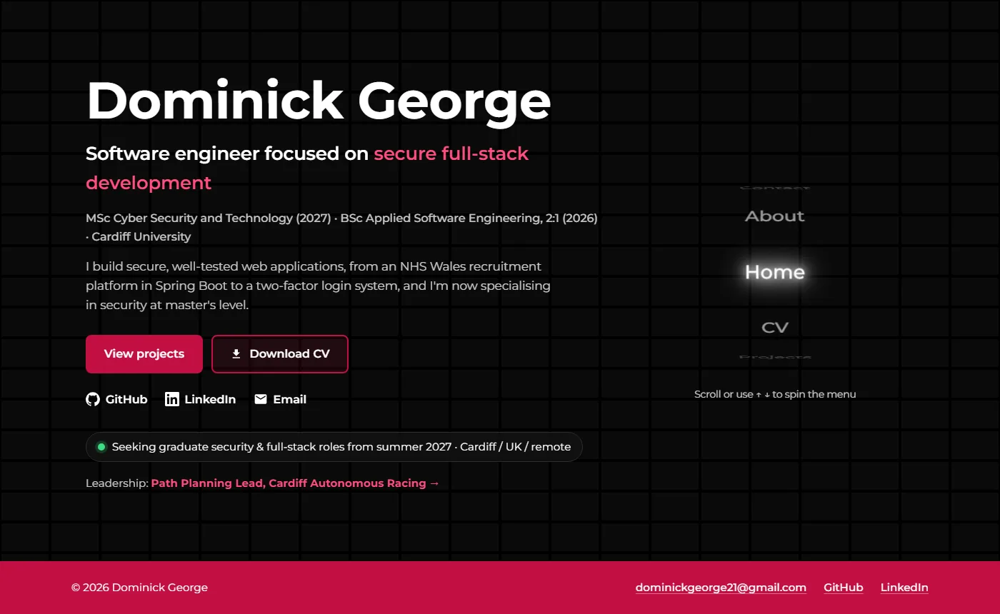

# domgeorge.dev

The source for my portfolio site, **[domgeorge.dev](https://domgeorge.dev)**.

I'm a software engineer (BSc Applied Software Engineering, Cardiff University, 2026) studying an MSc in Cyber
Security, looking for graduate security and full-stack roles. The site covers my projects, CV and how to contact me.



## How it's built

- **Plain HTML, CSS and JavaScript.** No frameworks, no build step and no third-party JavaScript. Hosted on GitHub Pages.
- **Strict Content Security Policy** on every page. Scripts, styles, images and frames load only from this origin, plus
  Google Fonts for the typeface. There's also a [`security.txt`](.well-known/security.txt) for reporting issues.
- **Fast.** Images are resized WebP files with explicit dimensions and lazy loading. Most pages transfer under 200 KB.
- **Accessible.** Semantic landmarks, a skip link, visible focus styles, alt text on every image, keyboard support for the
  3D menu and carousels, and `prefers-reduced-motion` support.
- **Checked in CI.** A GitHub Actions workflow validates the HTML and checks every link on each push and pull request.

## Structure

```
index.html, about.html, projects.html, cv.html, contact.html, 404.html
projects/            one page per project (case studies)
static/styles/       base.css (shared) plus one stylesheet per page type
static/js/           main.js (mobile nav), carousel.js, 3d_menu.js, index_anim.js
static/imgs/         WebP screenshots and photos, og-image.png for link previews
static/documents/    cv.pdf
```

## Running locally

Links are root-relative, so serve the repository root rather than opening files directly:

```sh
python -m http.server 8000
# then visit http://localhost:8000
```

Run the same checks as CI:

```sh
npx html-validate@8 "*.html" "projects/*.html"
```
